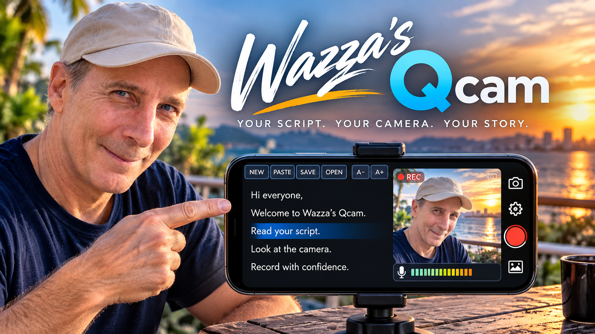
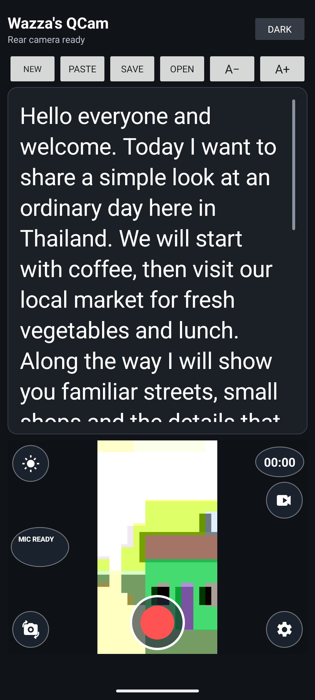
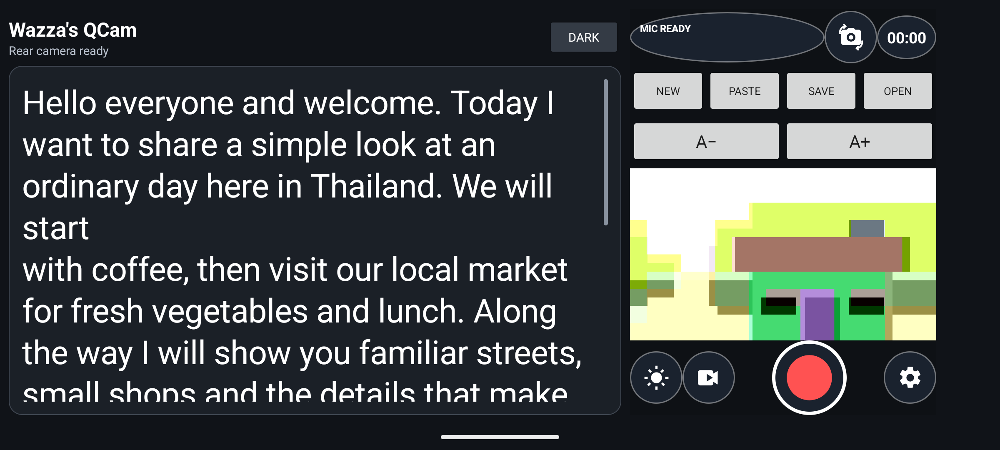
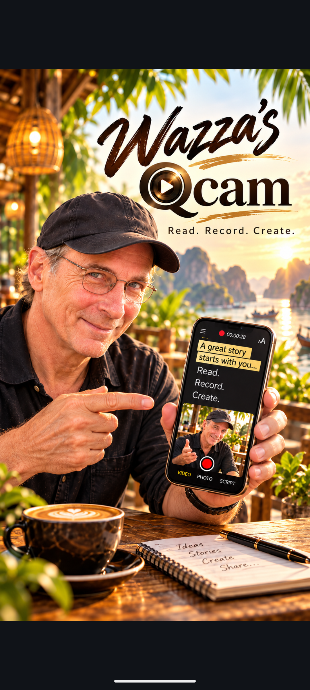
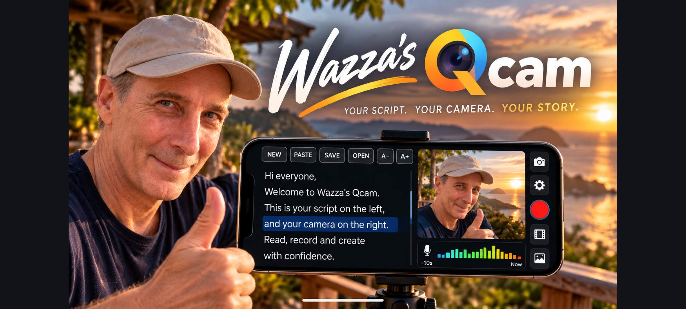
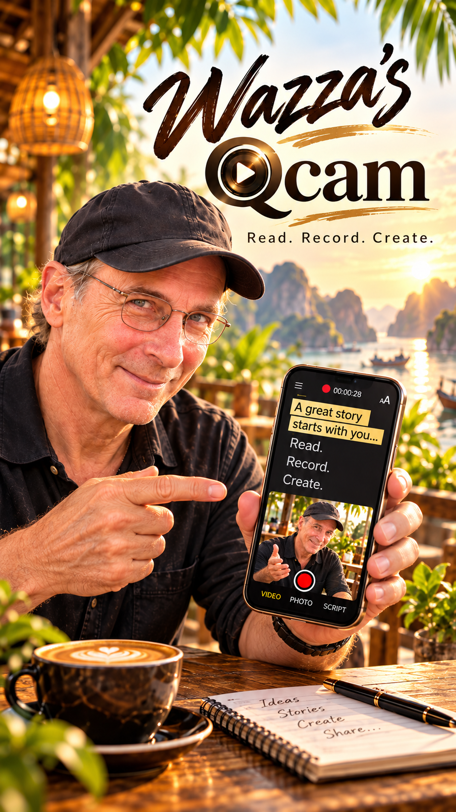

# Wazza's QCam

**A free, offline Android teleprompter and camera for recording your own story.**

<p align="center"></p>

[**Download Wazza's QCam 1.0.0 APK**](https://github.com/PopeKael/wazzas-qcam/releases/latest/download/Wazzas-QCam-1.0.0.apk) · [Install guide](#install-on-android) · [Source and build](#build-from-source) · [Report a bug](https://github.com/PopeKael/wazzas-qcam/issues)

Wazza's QCam keeps your script and camera preview on one screen. Read and scroll your words at your own pace while framing the shot, then record a full-resolution video with microphone audio. The final video contains the camera image and sound, not the app screen or your script.

| Portrait | Landscape |
| --- | --- |
|  |  |

Portrait and landscape splash screens use owner-approved artwork, randomly selected from the matching orientation set at each launch.

| Portrait startup | Landscape startup |
| --- | --- |
|  |  |

<p align="center"></p>

## What it does

- **Teleprompter and camera together:** the script and live preview share the screen; landscape puts the script at left and camera controls at right.
- **Scripts:** type or paste from the clipboard, change reading size, save multiple named scripts, reopen them, and recover the working draft after a restart. Scrolling is manual; the app does not auto-scroll.
- **Recording:** CameraX records video and microphone audio directly to MP4 through Android MediaStore. The preview frame follows the phone orientation, and the timer and stop control stay visible.
- **Camera controls:** switch front/rear cameras, see a live microphone-level graph while recording, adjust this app's screen brightness, and choose a recording quality offered by the selected camera.
- **Video review:** open saved recordings from `Movies/WazzaCueCam` in the phone's installed video player.
- **Local by design:** scripts stay in app-private storage and recordings stay on the device. The app requests no Internet permission, uses no account, advertising, analytics, cloud service, or in-app payment.

Recording options are device-specific. The app offers the qualities CameraX reports for the selected camera, up to 4K UHD. On the tested OPPO Reno15 Pro 5G (Android 16), the rear camera reported 4K UHD, 1080p, 720p and SD; the front camera reported 1080p, 720p and SD. Front-camera 4K was not reported by CameraX on that device. Other phones can expose different options.

## Install on Android

1. Download the APK from [GitHub Releases](https://github.com/PopeKael/wazzas-qcam/releases/latest).
2. Open the downloaded APK from the phone's Downloads notification or Files app.
3. If Android asks, allow that app to install this downloaded file, review the installer prompt, and tap **Install**.
4. Open Wazza's QCam and allow camera and microphone access when you want to record.

The APK is distributed directly from GitHub; it is not listed in Google Play. Android's wording and the one-time install permission vary by phone manufacturer. You can revoke the install permission for Files or your browser after setup.

> **Existing development builds:** test APKs signed with Android's debug key cannot be updated in place with the separately signed public release. Do not uninstall a debug build if you need the scripts stored inside it. The public release keeps the same application ID (`au.wazza.cuecam`), but Android requires the matching signing key to update an installation. Recordings already saved under `Movies/WazzaCueCam` are outside app storage and remain on the device after uninstall; app-private scripts do not.

## Build from source

Requirements: JDK 17 and Android SDK Platform 35. On Windows, open PowerShell in the repository and run:

```powershell
.\gradlew.bat clean testDebugUnitTest assembleDebug
```

On macOS or Linux:

```sh
./gradlew clean testDebugUnitTest assembleDebug
```

The debug APK is written to `app/build/outputs/apk/debug/app-debug.apk`. Debug APKs are signed with the machine's Android debug key and are for development. Do not publish a debug-signed APK as a stable update.

The application uses `au.wazza.cuecam`, minimum Android SDK 23, target SDK 35, CameraX 1.4.1, AndroidX Activity 1.9.3 and AndroidX Core 1.15.0. To inspect runtime dependencies, run `./gradlew :app:dependencies --configuration releaseRuntimeClasspath`. See [third-party notices](THIRD-PARTY-NOTICES.md) before redistributing.

Stable release signing must use a private release keystore kept outside this repository. Never commit the key, its passwords, or a signed local properties file. See [release signing notes](docs/RELEASING.md); stable signing setup is maintained by the project owner.

## How this project came about

Wazza's QCam began as a customised derivative of the open-source [CueCam Android project](https://github.com/lustsazeus-lab/CueCam), licensed under Apache License 2.0. It became a different tool through iterative, AI-assisted engineering: Codex helped implement changes, while Wazza directed the design, reviewed each working build, and checked the app on an Android emulator and a physical OPPO phone.

Practical filming shaped the interface: keep the script readable while the phone frames the shot; preserve touch scrolling during recording; keep the controls reachable in portrait and landscape; show actual microphone activity from CameraX statistics; and make saved clips easy to review. The local script library, camera settings, orientation-aware splash art, and recording controls were refined against real use rather than a mock-up. See the [development milestones](docs/DEVELOPMENT-HISTORY.md).

## Compatibility and limitations

- Tested on an Android 15 Pixel 8 emulator and an OPPO Reno15 Pro 5G running Android 16 / ColorOS 16.
- Available video sizes depend on the selected camera and device. The app reports CameraX capabilities; it does not promise that every camera supports 4K.
- The camera preview is for framing. Recorded output is the camera stream, not a screen capture.
- Script data is app-private and Android backup is disabled. Export/import between differently signed development and release builds is not currently provided.
- Android 6.0 (API 23) is the declared minimum. Other devices and Android versions have not all been tested.

## License and acknowledgements

The application source is distributed under [Apache License 2.0](LICENSE). Wazza's QCam is a derivative of CueCam by lustsazeus-lab; the upstream copyright and license are retained, and this project records its modifications in source-file notices and [NOTICE](NOTICE). The project owner supplied and approved the bundled brand artwork; that artwork is identified separately in [third-party notices](THIRD-PARTY-NOTICES.md) and is not relicensed by the source-code license.

## Help and community

Please [open an Issue](https://github.com/PopeKael/wazzas-qcam/issues) to report a reproducible bug or suggest an improvement. Include your Android version and phone model, the selected camera and recording quality, and steps to reproduce. Do not attach private scripts or recordings unless you have removed personal details. If GitHub Discussions is enabled for the repository, use it for questions and ideas that are not bug reports.

Support is optional: [Buy Me a Coffee](https://buymeacoffee.com/warrengerdes) · [Join the Tribe on Patreon](https://www.patreon.com/c/chanyawazza).

See [CONTRIBUTING](CONTRIBUTING.md) for the project’s bug-report and contribution workflow.
